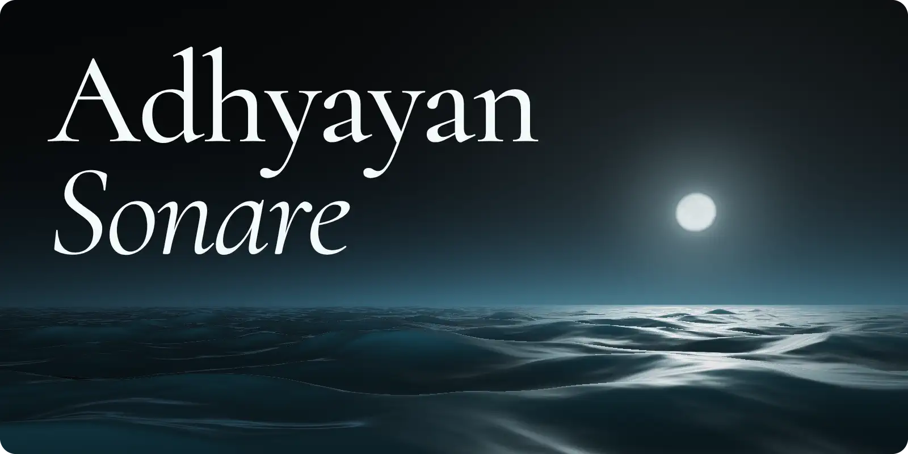
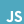
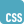
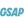
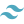
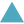
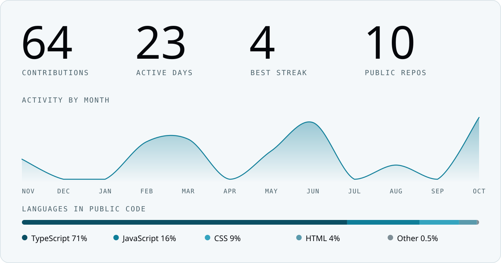
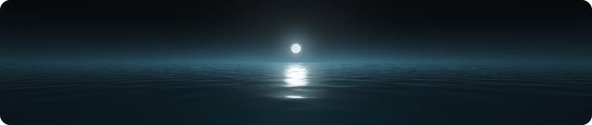

<strong>Full-stack developer. I build for the web, from the interface to the data.</strong>

  <a href="#about">About</a> &nbsp;·&nbsp;
  <a href="#tools">Tools</a> &nbsp;·&nbsp;
  <a href="https://x.com/AdhyayanSonare">X</a> &nbsp;·&nbsp;
  <a href="https://www.instagram.com/adhyayan_sonare/">Instagram</a> &nbsp;·&nbsp;
  <a href="mailto:adhyayansonare15@gmail.com">Email</a>

 

## About

I'm a second-year B.Tech CSE student at Symbiosis Institute of Technology. I taught myself web development and now work across the full stack.

I've worked on startup projects and national competitions, and I enjoy public speaking.

**Right now**

- Building with Astraon AI
- Learning AI and ML
- Exploring 3D on the web with Three.js and GSAP

 

## Tools

**Languages** 
<kbd> TypeScript</kbd> <kbd> JavaScript</kbd> <kbd> Python</kbd> <kbd> C</kbd> <kbd> C++</kbd>

**Interface** 
<kbd> React</kbd> <kbd> HTML</kbd> <kbd> CSS</kbd> <kbd> Three.js</kbd> <kbd> GSAP</kbd> <kbd> Tailwind</kbd>

**Server and data** 
<kbd> Node.js</kbd> <kbd> Express</kbd> <kbd> MongoDB</kbd>

**Build and deploy** 
<kbd> Git</kbd> <kbd> Vite</kbd> <kbd> Vercel</kbd>

 

## GitHub stats

<picture>
  <source media="(max-width: 1011px) and (prefers-color-scheme: dark)" srcset="assets/stats-dark-m.svg">
  <source media="(max-width: 1011px)" srcset="assets/stats-light-m.svg">
  <source media="(prefers-color-scheme: dark)" srcset="assets/stats-dark.svg">
  
</picture>

  

Every ring is a day of public work in the year to November 2026.

 

<h2 align="center">Say hello</h2>

Happy to talk about the web, 3D, or AI and ML. <a href="mailto:adhyayansonare15@gmail.com">adhyayansonare15@gmail.com</a>

